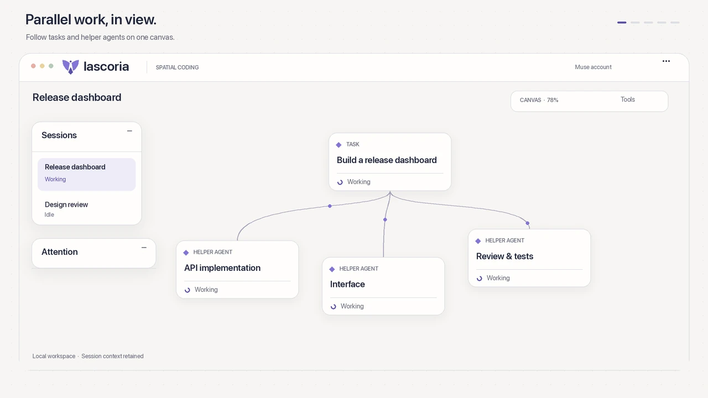
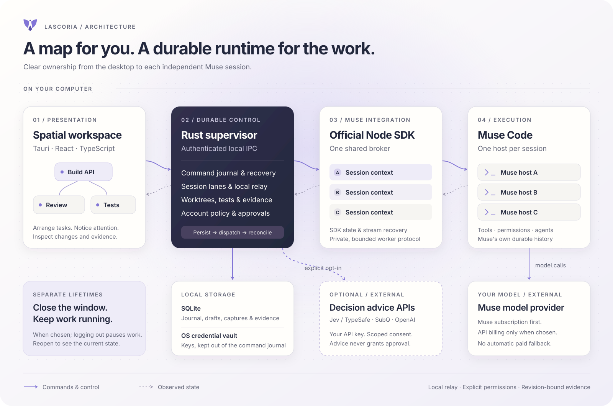

<h1>
  
  
</h1>

**The spatial coding workspace.** Give your agents room to work.

[](https://github.com/kabudu/lascoria/actions/workflows/validate.yml)
[](https://github.com/kabudu/lascoria/releases/latest)
[](LICENSE)
[](https://www.lascoria.org)

Lascoria is a desktop workspace for coding with Muse Code. Each session has an interactive map of its tasks, with your other sessions and the work that needs attention close at hand. See what is running, what needs your answer, and what changed across your repositories.

Arrange tasks and their relationships, move between parallel sessions, answer questions and approvals, then inspect the resulting code and test evidence. Each task still has a transcript; the canvas gives you a view of the whole piece of work.

[Features](#features) · [Architecture](#architecture) · [Decisions](#decisions) · [Run from source](#run-from-source) · [Documentation](#documentation)

[Download Lascoria for macOS, Windows or Linux](https://github.com/kabudu/lascoria/releases/latest). See the [installation and update guide](docs/RELEASE.md) for platform requirements and package verification.

## See it in motion

[](docs/media/lascoria-workspace.mp4)

[Watch the 24-second video](docs/media/lascoria-workspace.mp4) · [Read the transcript](docs/media/lascoria-workspace-transcript.md)

## Features

These workflows are implemented. Their platform-by-platform release acceptance is recorded separately in the [release-readiness backlog](docs/release-readiness.md).

| Work                         | What Lascoria provides                                                                                                                                                                                              |
| ---------------------------- | ------------------------------------------------------------------------------------------------------------------------------------------------------------------------------------------------------------------- |
| **Arrange your workspace**   | A full canvas with curved connections, direct node dragging, fit-to-view, cursor-centred zoom, trackpad gestures and floating, collapsible panels.                                                                  |
| **Work across repositories** | Named standalone sessions and reusable Projects with multiple folder references. Isolated tasks can use separate Git worktrees, including one per repository in a Project.                                          |
| **Notice what needs you**    | An attention queue for questions, approvals, failures and completed work, plus busy-node feedback and optional desktop notifications.                                                                               |
| **Inspect the result**       | Task transcripts, saved diffs, direct test runs, file browsing and evidence tied to the captured file contents. Open files in your editor or make a guarded local commit.                                           |
| **Use Muse naturally**       | Native model and effort selection, a searchable skill picker, staged image/video/text attachments, subscription usage and token counters where Muse reports them.                                                   |
| **Keep and recover work**    | Durable drafts, conflict handling, backups, restore, archive browsing, retained-transcript search and export. Background execution and explicit pause/logout flows keep window closure separate from stopping work. |
| **Connect local sessions**   | An opt-in relay between Muse sessions on the same computer, with explicit connections, local conversations, read state and scoped agent tools.                                                                      |
| **Add optional advice**      | Separate-key adapters for Jev/TypeSafe, SubQ and OpenAI Decisions: snapshot reviews, background triage or a Muse-callable tool, with workspace consent and inspectable request metrics.                             |

Lascoria is not a complete IDE. The first-release scope uses your existing editor and a bounded, non-interactive command runner. Guarded commits include all Git-visible changes and do not push; hooks and commit signing are disabled for that operation. Selected-hunk staging, push/pull requests, an embedded terminal and plugin/MCP management are on the [roadmap](ROADMAP.md).

## Architecture



[Open the architecture diagram at full size](docs/images/architecture.svg).

The **Tauri/React desktop** presents the workspace and sends narrow local requests. The **Rust supervisor** owns durable commands, recovery, session coordination, local sharing and developer-operated workspace actions. A shared **Node worker using the official Muse SDK** maintains independent session contexts and authoritative SDK state; a separate SDK account host handles sign-in observations. **Muse Code** runs the tools and agents, enforces its permissions and retains its own session history.

Local control uses an owner-restricted Unix socket on macOS/Linux or a local named pipe on Windows. SQLite holds Lascoria's journal, drafts and evidence; API keys belong in the operating-system credential vault. There is no remote control server or cross-machine session relay. Model requests still go to the selected provider, and separately enabled decision integrations send only within their disclosed scope.

The [protocol and design notes](docs/architecture.md) retain the original architecture decisions and their development history. Current behaviour and acceptance evidence are recorded in the [running checklist](docs/implementation-progress.md).

## Decisions

These choices shape the product, its trust boundaries and the first-release scope.

| Decision                                                              | Why it matters                                                                                                                                                                                                                                                                                  |
| --------------------------------------------------------------------- | ----------------------------------------------------------------------------------------------------------------------------------------------------------------------------------------------------------------------------------------------------------------------------------------------- |
| **A spatial overview, with transcripts for detail**                   | Parallel work has relationships and waiting points. The canvas makes those visible while transcripts remain available for the exact conversation.                                                                                                                                               |
| **Muse subscription first**                                           | Browser subscription login takes precedence over a saved API key. An expired subscription asks you to reconnect; it never silently switches to paid API billing. [Account policy](docs/accounts.md).                                                                                            |
| **Rust owns durable control; the official SDK owns Muse integration** | Recovery, command identity and local policy belong in one supervisor. The official SDK remains responsible for Muse's interactive state and protocol; a future Rust adapter would have to prove parity first. [SDK assessment](docs/rust-sdk-assessment.md).                                    |
| **A quiet default workspace**                                         | Collapsible panels, contextual controls and progressively disclosed diagnostics keep detailed metrics and settings available without filling the canvas with them. Light mode is the default; both themes share the same hierarchy. [Identity and design](docs/branding.md).                    |
| **The window and the work have separate lifetimes**                   | When chosen, work continues while the UI is closed, and reopening shows its current state. Explicit logout pauses work and blocks authenticated recovery until sign-in. Uncertain operations are never silently replayed. [Lifecycle](docs/accounts.md#active-work-window-closure-and-updates). |
| **Session sharing is local and explicit**                             | The relay connects selected sessions on one machine. A connection does not share filesystem authority, approve a tool or grant access to another project automatically. [Session communication](docs/session-communication.md).                                                                 |
| **Completion is not acceptance**                                      | A completed model turn is not proof that its code is correct. Captures, test results and human evidence retain their revision and provenance; changed content can make earlier evidence stale. [Coding workflow](docs/daily-coding-workflow.md).                                                |
| **Decision APIs are optional advice**                                 | They use separate keys and consent, remain off by default, and cannot approve tools or accept evidence. Their costs and observations stay separate from Muse subscription usage. [Decision assistance](docs/decision-assistance.md).                                                            |
| **Bounded work, visible failure**                                     | Sessions, queues, retained history, downloads and retries have explicit limits. An unavailable result or unknown outcome stays visible rather than becoming success. [Release requirements](docs/release-readiness.md).                                                                         |
| **Three operating systems, verified individually**                    | macOS, Windows and Linux are first-release requirements. A successful cross-build does not count as native acceptance, and a QA bundle does not count as a public release. [Native acceptance](docs/native-acceptance.md).                                                                      |

## Run from source

Development needs the pinned Rust toolchain (1.97), Node.js 24 or newer, Git and the native Tauri dependencies for your operating system. The currently tested Muse/SDK version is **1.4.10**. See [validation setup](docs/RELEASE.md) for the exact policy and dependencies.

```sh
npm ci
npm run desktop:dev
```

On first launch, choose a compatible Muse installation or use onboarding to install the tested version. Continue with your Muse account in the browser, or explicitly configure an API key. Create a session from an existing Git repository, or create a named Project with its folder references.

`npm run desktop:build` produces a native development binary with installed worker resources. Packaging and signing instructions are in the [release policy](docs/RELEASE.md); development and QA builds are not supported public downloads.

### Validate changes

Bootstrap dependencies separately, then run:

```sh
./scripts/ci-local.sh
```

Local CI is authoritative while the repository is private and hosted Actions is disabled. It checks repository/privacy rules, formatting, static analysis, Rust tests, real Muse integration with controlled local providers and the React/native-bridge workflows. It installs no dependencies and makes no paid-provider calls. Native installation, live-provider and accessibility acceptance are separate checks, not implied by a green suite.

For the repeatable runtime and synthetic UI benchmarks, use `npm run benchmark:runtime` and `npm run benchmark:ui`. Measurements, workloads and limitations are recorded in [Stage C](docs/stage-c.md) and [resource efficiency](docs/resource-efficiency.md).

### Diagnostic client

The diagnostic CLI is for development and recovery inspection. Give independent runs separate state directories; do not start one against a running user installation for testing.

```sh
npm run build
npm start -- up
npm start -- start '{"workspace":"/absolute/path/to/repository"}' session-one
npm start -- status
```

Its default provider is credential-free Echo. Select `SCH_PROVIDER=meta` before starting an isolated service for live work; its unmanaged credential rules differ from the desktop's subscription-first policy. Keep a stable request ID when retrying, and inspect an unknown outcome before issuing a new mutation. [Protocol and recovery](docs/architecture.md#protocol-and-recovery) explain the command contract.

## Documentation

| Guide                                                                                                         | Start here for                                                                   |
| ------------------------------------------------------------------------------------------------------------- | -------------------------------------------------------------------------------- |
| [Daily coding workflow](docs/daily-coding-workflow.md)                                                        | Worktrees, test execution, captured changes, commits and archive/continuation.   |
| [Accounts](docs/accounts.md)                                                                                  | Subscription versus API billing, login, credentials and background work.         |
| [Projects](docs/projects.md) and [attachments](docs/attachments.md)                                           | Folder context, multi-repository ownership and staged inputs.                    |
| [Local session communication](docs/session-communication.md)                                                  | Explicit connections, local conversations and agent interaction.                 |
| [Decision assistance](docs/decision-assistance.md)                                                            | Optional providers, disclosure, consent, advice and metrics.                     |
| [Release readiness](docs/release-readiness.md) and [implementation progress](docs/implementation-progress.md) | Requirements, completed increments, validation evidence and open gates.          |
| [Security review](docs/security-review.md) and [public-opening gates](docs/public-launch.md)                  | Threat boundaries, known findings, privacy review and distribution requirements. |
| [Roadmap](ROADMAP.md) and [changelog](CHANGELOG.md)                                                           | Accepted later scope and the implemented change history.                         |

## Contributing and project status

Read [CONTRIBUTING.md](CONTRIBUTING.md) and [AGENTS.md](AGENTS.md) before implementation or validation. Keep changes scoped, preserve existing sessions and questions, use isolated QA state, and include behavioural evidence for recovery, security and native-platform claims. Keep credentials and raw live captures out of source control and issue reports.

For help and non-sensitive reports, see [SUPPORT.md](SUPPORT.md). Report suspected vulnerabilities through [SECURITY.md](SECURITY.md), not public issue details. Public-opening and reporting-channel verification remain in the [public-launch checklist](docs/public-launch.md).

## Licence

Lascoria is licensed under the [Apache License, Version 2.0](LICENSE), with copyright and attribution in [NOTICE](NOTICE). Third-party components keep their own licences and notices, including the official Muse SDK's [MIT notice](third-party/MUSE-SDK-LICENSE).
